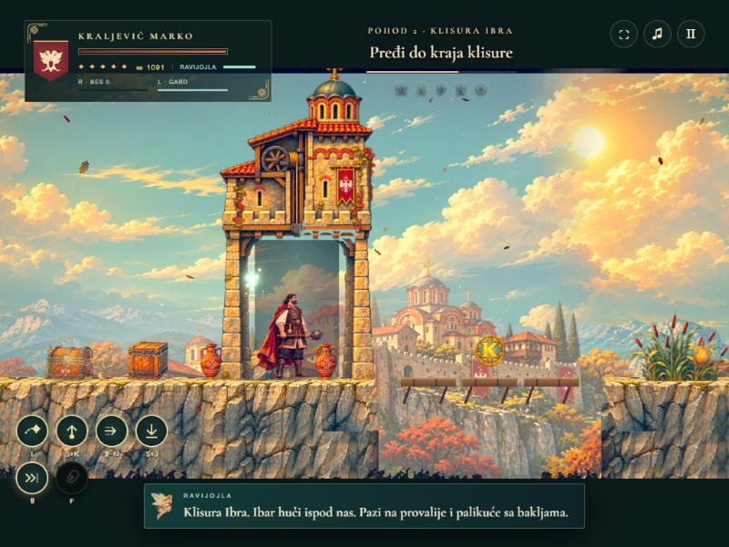
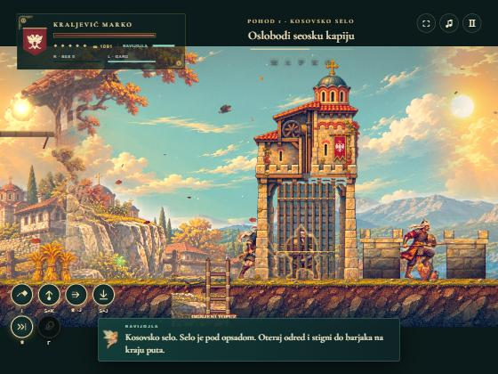
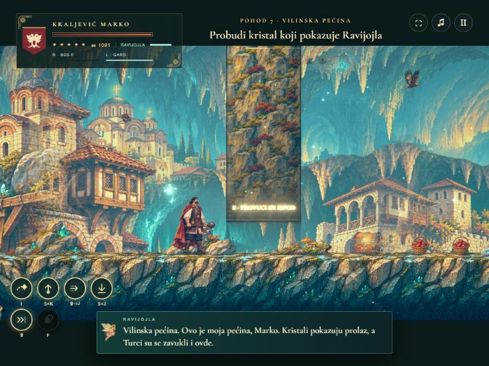
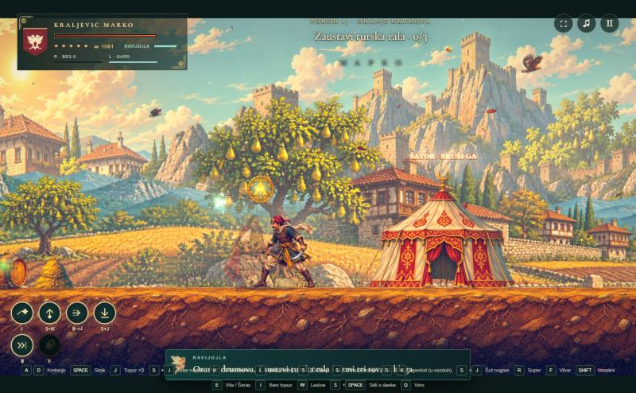

# Jutarnji izveštaj — noć 8. na 9. novembar

Svih osam noćnih krugova je završeno i sve je na `main`, pa je GitHub Pages ažuriran.

## Ukratko
- **Kapije se prolaze KROZ, a ne pored.** Kapija se crta ispred Marka: on ulazi između stubova, iza njega je taman tunel, rešetka se diže u kulu kad se kapija otvori.
  - Codex je nacrtao kamenu, drvenu i rudničku kapiju iz profila. Sve su u igri.
- **Marko je fluidniji.**
  - Novi mirni idle, bez trzaja glavom ka kameri.
  - Iste visine u svim pozama (više se ne „smanji“ kad krene da trči).
  - Okret, prvi korak, doskok.
  - Hod u čučnju, hod sa blokom i hod dok puni K.
  - Posle vihora mu se zavrti u glavi, padne i polako ustaje.
  - Mnogo manje stenjanja.
- **Neprijatelji:**
  - svi imaju animaciju kad ih baciš u vazduh (S+K aperkat);
  - četiri reakcije: štit odbijen, oklop puca, akindžija odskače, palikuća gori;
  - mirno dišu u mestu;
  - iz turskih šatora izlaze Osmanlije.
- **Svet:**
  - nebo više ne menja boju na spojevima pozadine;
  - propovi (drveće, kuće, ćupovi) stoje celi na tlu, ništa ih ne seče, nisu na zamkama, i ima ih 2–5 puta više.
- **Zagonetke i tok:**
  - nizak zid ispod kog se provlačiš čučeći ili klizanjem;
  - šut neprijatelja na kolje;
  - bolji ritam soba;
  - bot prolazi svih 13 pohoda bez zaglavljivanja.

## Snimci
| | |
|---|---|
|  |  |
| Marko unutar otvorene kapije: stubovi oko njega, tunel iza. | Zatvorena kapija: rešetka spuštena, janičar iza nje. |
|  |  |
| Nizak zid u Vilinskoj pećini: „S · PROVUCI SE ISPOD“. | Turski šator u Oranju: iz njega izlaze Osmanlije, dok ga ne srušiš. |

Snimci kapija su napravljeni pre nego što je stigla drvena kapija. Selo sada ima drvenu kapiju, a Klisura kamenu.

## Kako da probaš
**Nove komande:**
- **S + K** — aperkat, baca neprijatelja u vazduh. Odmah posle Space skočiš za njim, pa J J J u vazduhu.
- **S + J** — šut nogom: odbija štit u stranu i gura neprijatelja (može i na kolje i sa ivice).
- **S dok trčiš** — klizanje, podseca neprijatelje.
- **S + A/D** — hod u čučnju. **L + A/D** — hod iza bloka. **Drži K + A/D** — hodaš dok puniš udarac.
- **F (vihor)** — kad se završi, Marku se zavrti u glavi: oko sekund se tetura, padne i polako ustaje. Ranjiv je za to vreme, zato pazi kad ga koristiš.
- **Ivica** — ako pustiš strelice dok visiš, Marko ostaje da visi. Ka zidu ili W ga penje, S ga pušta.

**Gde je šta:**
- **Kapije:** Kosovsko selo (drvena), Klisura Ibra (kamena), Rudnik (rudnička). Kapije na polugu koriste iste crteže.
- **Šatori:** Oranje, Tvrđava, Prevoj, Reka. Teški udarci (K) ih brže ruše.
- **Nizak zid:** Pećina, Rudnik, Podrum, Ruševine, Manastir, Klisura.
- **Riznica sa ključem:** ključar (ključ mu lebdi iznad glave) nosi ključ. Kad otključaš, vrata se sada stvarno otvore (Codex-ov crtež), unutra se vide baklje i sanduci.

**Za proveru iz konzole:**
- Otvori igru sa `?dev`, npr. `http://localhost:4173/?dev`.
- `markoDev.startLevel(i)` pokreće pohod, `markoDev.layoutAudit()` prijavljuje propove koji vise, lebde ili stoje na zamkama. Za sve pohode, u sve tri verzije, sada je prazno.

## Po krugovima
1. **00:04**
   - Codex ponovo proradio kroz terminal (vidi napomenu dole).
   - Visine izjednačene za Marka i sve neprijatelje, uz novi test.
   - Mirni idle, hod u čučnju, sa blokom i dok puni K.
   - Vrtoglavica i pad posle vihora; manje stenjanja.
2. **01:04**
   - Ugrađeno 17 Codex animacija: okret, prvi korak, doskok, hod u čučnju, hod sa blokom, hod dok puni K, vrtoglavica; bacanje u vazduh za svih 9 neprijatelja; 4 reakcije.
   - Turski šatori.
3. **02:04**
   - Pozadine bez šavova (svih 195 slojeva, uz test).
   - Propovi stoje celi i ima ih više.
   - Nema više poruke „Kapija se otvorila“ na početku sela.
4. **03:04**
   - Nizak zid; šut na kolje.
   - Provera ritma soba (nikad tri zamke zaredom, odmor bar na svakih šest soba); ispravljena četiri pohoda.
5. **04:04**
   - Kapije kroz koje Marko vidljivo prolazi (kamena).
   - U prolazu kapije nema sanduka ni ćupova.
6. **05:04**
   - Bot prolazi sve pohode (17 s, deo `npm test`).
   - Doskok se oseća prema visini pada.
   - Natpisi se više ne preklapaju.
7. **06:04**
   - Neprijatelji mirno dišu (najveći skok kadra npr. janičar 16.8 → 7.0).
   - Nijedan prop na zamci ni u sobi sa zamkom (proveravano u sve tri verzije pohoda).
   - Drvena kapija.
8. **07:04**
   - Rudnička kapija i otvorena riznica.
   - Ovaj izveštaj.

## Šta je Codex isporučio
- **Marko (8):** idle-2, crouch-walk, block-walk, charge-walk, dizzy, turn, run-start, land.
- **Neprijatelji u vazduhu (9):** sword, shield, archer, akindzija, kopljanik, palikuca, pas, tufekdzija, oklopnik (prva tri još sinoć).
- **Reakcije (4):** shield-guardbreak, oklopnik-armorbreak, akindzija-backstep, palikuca-burn.
- **Kapije:** prolaz-kamen-otvoren, prolaz-drvo-otvoren, prolaz-rudnik-otvoren, ulaz-riznica-otvoren (+ prolaz-kamen-zatvoren, nije potreban jer igra spušta rešetku).

**Napomena o Codex-u:**
- Desktop aplikacija drži originalnu nit zaključanu, pa je Codex noću radio u **kopiji te niti** (fork, sesija `01a1bd68-2fcf-7023-b45f-bba9e4d3c10e`), pokrenutoj iz terminala. Te poruke nećeš videti u aplikaciji, ali je sve upisano u `art/world-pack-03/STATUS.md`.
- Workspace je oko 00:35 ostao bez kredita, a krediti su se vratili oko 06:00. Lista za Codex je sada prazna; nisam mu davao nove zadatke.

## Šta čeka
- Zatvorene kapije svih stilova koriste istu gvozdenu rešetku. Drvena kapija bi lepše izgledala sa drvenom rešetkom; to bi bio mali zadatak za Codex.
- Bot ne ume sam da reši lift, okno za skok od zida i rala. Te zagonetke proveravaju posebni testovi.
- Sve provere prolaze:
  - `npm test`: igra, visine, pozadine, 13 pohoda / 19 ciljeva, 135 mehaničkih provera, bot;
  - `node simulation-test.mjs`: pobeda u Kačaniku;
  - `node animation-tests.mjs`.
